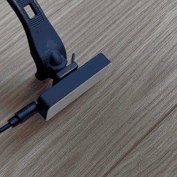
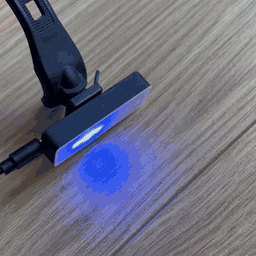
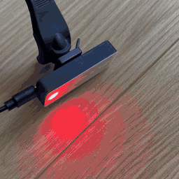

# Arduino bike light

A rear bike light built from an Arduino and an 8-LED NeoPixel stick, in a 3D-printed housing that clips onto the Decathlon Elops rear light mount. Every time you power it on it cycles to the next of three modes.

## Modes

The current mode is stored in EEPROM. Power-cycling the board advances to the next one.

<table>
  <tr>
    <th width="33%" align="center">1. Rear light</th>
    <th width="33%" align="center">2. Chase</th>
    <th width="33%" align="center">3. Demo</th>
  </tr>
  <tr>
    <td align="center"></td>
    <td align="center"></td>
    <td align="center"></td>
  </tr>
  <tr valign="top">
    <td>Quick red double-flash on all 8 LEDs, like a regular bike tail light</td>
    <td>A red "eye" sweeps along the stick, then a blue one sweeps back, twice over at two speeds</td>
    <td>Every pattern in the sketch, back to back: white flash-all, fast red/blue switch, police strobe, police wave, converge</td>
  </tr>
</table>

> **Note:** the red and blue police-style strobes are there as a demo of what the strip can do. Using them on a public road is likely illegal where you live, so keep the demo mode for the workshop.

## Hardware

- [Adafruit NeoPixel Stick, 8 x WS2812 5050 RGB LEDs](https://www.adafruit.com/product/1426)
- Arduino (a cheap clone works, anything with an AVR and EEPROM such as a Nano or Pro Mini)
- 3D-printed housing (files in [`hardware/3d-print`](hardware/3d-print))
- A [Decathlon Elops ST 920 rear light](https://www.decathlon.pt/p/luzes-led-de-bicicleta-frente-e-tras-st-920-usb-conjunto/313171/m8576352) mount, which the housing clips onto

### Wiring

| NeoPixel stick | Arduino |
| --- | --- |
| DIN | D2 |
| 5VDC | 5V |
| GND | GND |

The data pin is set by `neoPixel` at the top of the sketch. Change `brightness` (1 to 255) there too if 220 is too bright for your taste or your power source.

### 3D-printed housing

The housing is two parts, a base that holds the NeoPixel stick and a snap-on cover. Modelled in [Plasticity](https://www.plasticity.xyz); the source file is included alongside the STLs.

| File | Size |
| --- | --- |
| `bike-light-base.stl` | 58 x 21 x 14 mm |
| `bike-light-cover.stl` | 58 x 21 x 4 mm |
| `bike-light-source.plasticity` | Plasticity source |

The base is shaped to slide onto the Elops rear light support that comes with the Decathlon light set, so you can swap the stock light for this one without touching the bike.

### Power

Right now the light has no battery of its own. It runs off an external USB power bank plugged into the Arduino.

A version with a built-in battery and BMS may come in the future, if I find the time.

## Firmware

1. Install the [Adafruit NeoPixel library](https://github.com/adafruit/Adafruit_NeoPixel) from the Arduino IDE Library Manager.
2. Open `firmware/microStrobe-multimode/microStrobe-multimode.ino`.
3. Select your board and port, then upload.

The strobe patterns started life as a "police strobe" sketch inspired by [this video](https://www.youtube.com/watch?v=YZSK80aEbRE).

## License

MIT. See [LICENSE](LICENSE).
